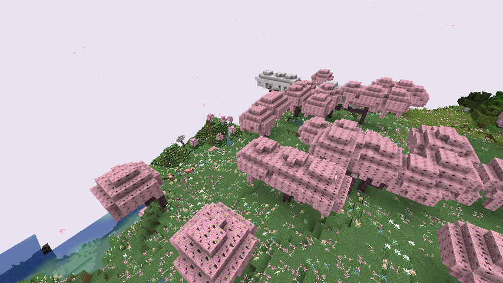
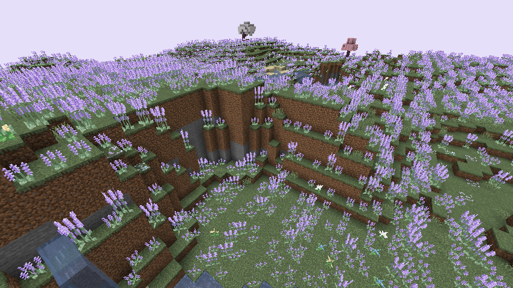
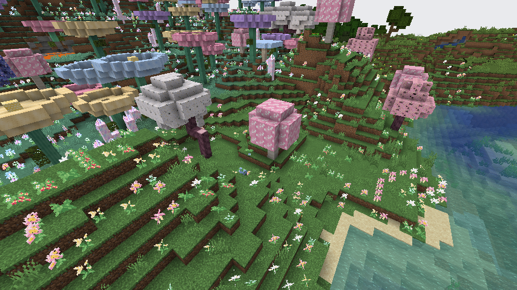
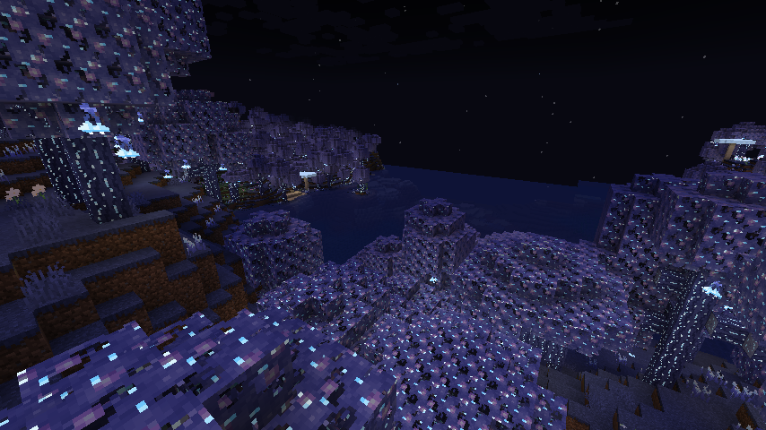
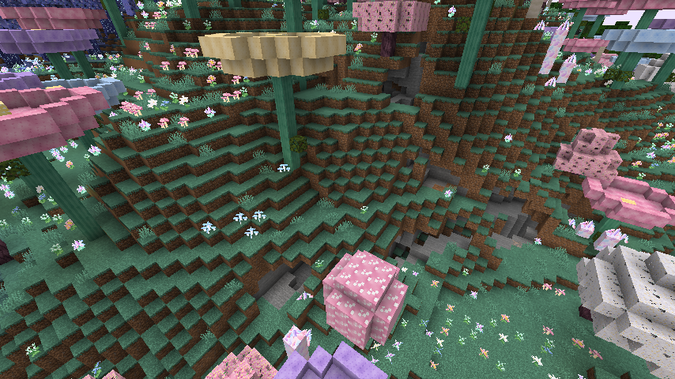
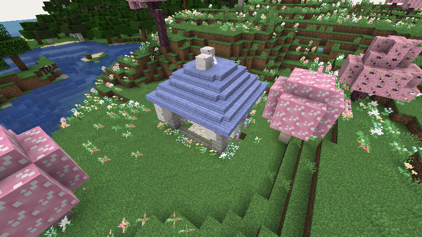
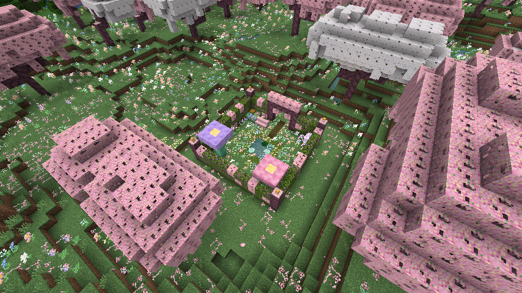
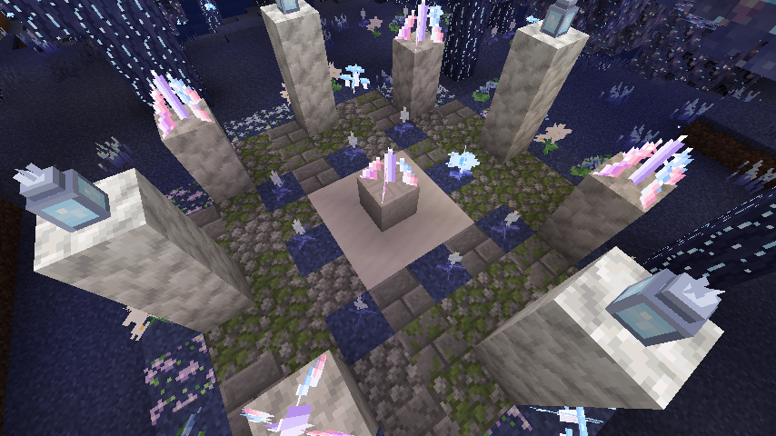
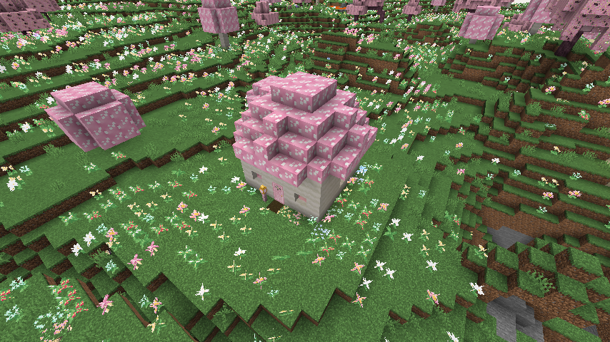
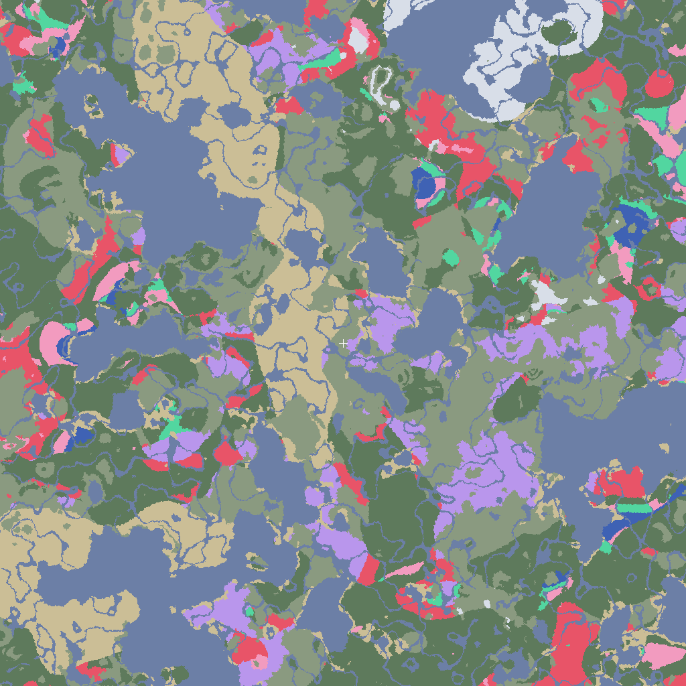

# Fairy Garden 🌷



*A Sugarplum Studios mod for Minecraft Java 1.20.1 (Forge 47.x) · requires [TerraBlender](https://www.curseforge.com/minecraft/mc-mods/terrablender) 3.0.1+*

Fairy Garden makes exploring more magical: five pastel fantasy biomes full of blossom trees, lavender
rows, strawberry patches, glowing moonlit plants, giant flowers, crystal outcrops and enchanted ponds,
with tiny magical creatures, drifting petals and fairy sparkles, hidden structures and treasure.

---

## Biomes

| Biome | Replaces (inside the Fairy Garden region) | Highlights |
|---|---|---|
| **Blossom Valley** | Meadow, Cherry Grove, Birch Forest | Pink and snow-white blossom trees (some with bee nests), flower-covered hills, blush grass, fallen petals, meandering little streams, falling-petal particles, birdsong |
| **Lavender Fields** | Sunflower Plains, Savanna | Endless combed rows of lavender and tall lavender (with meadow clearings), starflowers and bluebells, butterflies, warm breeze ambience with passing bees, lavender-tinted sky |
| **Strawberry Meadow** | Plains | Strawberry bushes, cream buttercups and tiny flowers, flower carpets, cute fairy mushrooms and fairy rings, giant spotted mushrooms, hydrangeas, birdsong |
| **Moonlight Forest** | Dark Forest | Dense moonwood forest with glowing bark veins and hanging glowing moonbells, moonflowers that open at night, moonlit grass, glowcap rings and giant glowcaps, moonlight motes, night ambience, rare **Moon Wisps** at night |
| **Fairy Glade** | Flower Forest, Old Growth Birch Forest | Giant flowers, crystal formations, crystal flowers, enchanted ponds with glimmer lilies, giant mushrooms and glowcaps, floating fairy sparkles, magical ambience |

| Lavender Fields | Strawberry Meadow |
|---|---|
|  |  |
| **Moonlight Forest** (night) | **Fairy Glade** |
|  |  |

The palette is deliberately balanced: pink, lavender, cream, mint, white and soft blue, with each biome
having its own grass, foliage, water, fog and sky colours (mint grass in the glade, blue-violet grass and
water in the moonlit forest, lavender sky over the fields).

How placement works: Fairy Garden registers one **TerraBlender overworld region**. Inside that region the
world looks like vanilla except the listed vanilla biomes are swapped for Fairy Garden ones, so terrain fits
naturally (Blossom Valley inherits meadow hills and plateaus, Moonlight Forest the dense dark-forest slots).
Villages, pillager outposts, woodland mansions and trail ruins still spawn in the biomes that replaced their
hosts.

## Blocks

**Two full wood sets — Blossom (pink) and Moonwood (periwinkle, with glowing bark veins):**
log, wood, stripped log, stripped wood, planks, stairs, slab, fence, fence gate, door, trapdoor, pressure
plate, button, sign, hanging sign, boat and chest boat. Logs strip with an axe; everything burns, works as
fuel and fits the vanilla wood tags (crafting tables, chests, sticks… all accept the planks).

| Group | Blocks |
|---|---|
| Leaves & saplings | Blossom leaves (shed pink petals), Snow Blossom leaves (shed white petals), Moonwood leaves (release moonlight motes) + their saplings |
| Flowers | Rosy Daisy, Lavender, Cream Buttercup, Mint Posy, Starflower, Bluebell, **Moonflower** (opens and glows at night), **Crystal Flower** (glows, sparkles), Tall Lavender, Fairy Foxglove — all pottable, all make dyes |
| Ground cover | Blossom Petals and Snow Blossom Petals (petal-covered ground, 1–4 per block), five Flower Carpets (pink, lavender, cream, mint, blue), Blush Grass, Moonlit Grass |
| Bushes | Pink, Blue and Lavender Hydrangeas; Strawberry Bush (4 growth stages, thornless) |
| Mushrooms | Fairy Mushroom, Glowcap (glows), Fairy Mushroom Block, Glowcap Block (glows) — bone meal grows huge ones |
| Giant flowers | Giant Flower Stem, Pink / Lavender / Blue / Cream Giant Petals (**soften falls to 20 %**), Giant Flower Pistil (glows, puffs pollen) |
| Magic | Fairy Crystal Block, Fairy Crystal Cluster (both glow and sparkle, chime when hit), Moonbell (hanging glowing flower), Glimmer Lily (glowing lily pad), **Fairy Lantern** and **Moon Lantern** (light 15/14, sparkle) |
| Other | Lavender Bale (like a hay bale) |

## Magical plants & items

* **Starbloom** — a crop planted from *Starbloom Seeds* (found in Fairy Garden chests and from breaking blush
  or moonlit grass). It **only grows at night under an open sky** and twice as fast under a full moon.
  Stages: sprout → bud → closed star (faint glow) → open starbloom (glows, sparkles). Ripe starbloom drops
  **Fairy Dust** plus extra seeds.
* **Moonflower** — closed by day, opens one by one after dusk (glows, gives off moonlight). Picking an
  *open* moonflower also gives a **Moon Petal**.
* **Fairy Dust** — magical fertiliser: right-click a starbloom to ripen it instantly (even by day), a
  moonflower to open it, or any bone-mealable plant for three rounds of growth. Also crafted from a crystal
  shard + glowstone dust + sugar. Moon Wisps sometimes drop it.
* **Strawberry**, **Strawberry Shortcake** (absorption), **Lavender Tea** (regeneration, cures
  nausea/poison, returns the bottle), **Crystal Shard**, **Flower Crown** (helmet, made from any fairy flowers).

### Flower collection
Every Fairy Garden flower can be collected (bone meal on grass in each biome grows that biome's flowers) and
crafted: into dyes, flower carpets (2 flowers + moss carpet), giant petal blocks (2×2), flower crowns, tea
and lanterns. The **Flower Collector** advancement asks for all ten flowers.

### Crafting highlights
| Result | Recipe |
|---|---|
| Fairy Lantern | 8 gold nuggets around fairy dust |
| Moon Lantern | 8 iron nuggets around a moon petal |
| Fairy Dust ×2 | crystal shard + glowstone dust + sugar |
| Fairy Crystal Block | 2×2 crystal shards |
| Flower Crown | `F S F` / `F _ F` (F = any fairy flower, S = string) |
| Flower Carpet ×4 | 2 matching flowers + moss carpet |
| Giant Petals | 2×2 blossom petals / lavender / bluebells / cream buttercups |
| Glimmer Lily | lily pad + fairy dust |
| Lavender Tea | glass bottle + 2 lavender + sugar |
| Strawberry Shortcake ×2 | 2 strawberries + wheat + sugar + egg |
| Lavender Bale | 9 lavender (and back) |

## Creatures
* **Butterfly** — ambient, by day, in six colourways chosen per biome; flutters from flower to flower.
* **Moon Wisp** — rare, at night in the Moonlight Forest and Fairy Glade; glows, trails moonlight, is drawn to
  open moonflowers and fades away at sunrise.

## Exploration
| Discovery | Where | Treasure |
|---|---|---|
| **Flower Shrine** (blossom or lavender style) | Blossom Valley, Lavender Fields, Strawberry Meadow | chest behind the crystal-flower altar |
| **Hidden Fairy Garden** — a walled hedge garden with giant flowers, a lily pond and lanterns | Fairy Glade, Blossom Valley | chest hidden behind the hydrangeas |
| **Moonstone Circle** — standing stones with moon lanterns around a quartz altar | Moonlight Forest | chest **buried beneath the altar** |
| **Mushroom Cottage** — a fairy's house inside a giant spotted mushroom | Strawberry Meadow, Fairy Glade | pantry chest |
| **Fairy Cache** — a rare buried chest under a crystal flower inside a small mushroom ring | every Fairy Garden biome | dig straight down from the flower |
| Fairy rings, crystal formations, enchanted ponds, giant flowers, streams | per biome | — |

The four buildings only generate on dry, fairly level ground: the terrain under the footprint may vary by at most
3 blocks (shrine, cottage) or 4 (hedge garden, moonstone circle). That way they sit naturally in the landscape,
not in a dug-out pit on a hillside or half over a lake. Roughly half of the candidate spots in hilly biomes are
skipped for this reason, so the placement grids are denser to keep each structure as common as it would be without the check.

| Flower Shrine | Hidden Fairy Garden |
|---|---|
|  |  |
| **Moonstone Circle** (night) | **Mushroom Cottage** |
|  |  |

## Ambience
Custom synthesized sounds: birdsong (Blossom Valley, Strawberry Meadow), breeze and bees (Lavender Fields),
night crickets/owls (Moonlight Forest), fairy chimes and a magical pad (Fairy Glade), crystal chimes, the
moonflower bloom, fairy dust and moon wisps, plus an original music-box track that plays in the biomes.
Particles: falling petals, butterflies, fairy sparkles, moonlight motes and pollen, spawned only around the
local player (client-side, scaled by the vanilla particle setting).

## Configuration
`config/fairygarden-common.toml` (world generation; restart required, affects new chunks):

| Option | Default | Meaning |
|---|---|---|
| `regionWeight` | 8 | Weight of the Fairy Garden region vs. other TerraBlender regions (vanilla is 10). Higher = more fairy biomes; 0 disables them |
| `blossomValley`, `lavenderFields`, `strawberryMeadow`, `moonlightForest`, `fairyGlade` | true | Toggle each biome (a disabled biome leaves the vanilla biome in place) |

`config/fairygarden-client.toml`: `ambientParticles` (on/off) and `ambientParticleDensity` (0–3).

Structure frequency is data-driven (`data/fairygarden/worldgen/structure_set/*.json`) and can be changed with
a datapack. The ground tolerance is `max_height_difference` in `data/fairygarden/worldgen/structure/*.json`.

## Finding the biomes and testing the features
**Guided tour (development client):** `gradlew runClient -Pshowcase` creates a new world called *Fairy Garden
Showcase*. A camera then circles every biome (Moonlight Forest and Fairy Glade by night too) and every
structure, showing a caption and a few notes at each stop. That takes about 3 minutes. At the end you land in
Creative beside the last structure, and the world is yours to play in. During the tour, Sneak skips a stop, Esc
(or any open screen) pauses it, and leaving the world ends it. Each stop is also saved as
`run/screenshots/showcase_*.png`. Each run makes a new world; earlier showcase worlds stay in the Singleplayer
list.

To explore on your own instead, create a **new world** (existing chunks don't change). With cheats on:

```
/locate biome fairygarden:blossom_valley
/locate biome fairygarden:lavender_fields
/locate biome fairygarden:strawberry_meadow
/locate biome fairygarden:moonlight_forest
/locate biome fairygarden:fairy_glade
/locate structure fairygarden:flower_shrine
/locate structure fairygarden:hidden_fairy_garden
/locate structure fairygarden:moonstone_circle
/locate structure fairygarden:mushroom_cottage
```
Click the green coordinates in chat to teleport. With the default weight, each biome is usually within
1–2 thousand blocks of spawn. The F3 screen shows the biome you are standing in.

Things to try:
* **Day vs. night** — `/time set night` in a Moonlight Forest or Fairy Glade: moonflowers open one by one,
  moonbells, glowcaps and moonwood bark glow, moon wisps appear (`/summon fairygarden:moon_wisp` to see one at
  once), moonlight motes drift. `/time set day` brings out butterflies.
* **Starbloom** — plant seeds on farmland and wait for night under open sky (or use fairy dust).
* **Fairy dust** — right-click a closed moonflower, a starbloom, or grass.
* **Giant petals** — jump off something tall onto a giant flower.
* **Treasure** — open the chests in the structures; dig under the crystal flower in the middle of a small
  mushroom ring to find a fairy cache.
* **Signs, hanging signs, boats, doors** — craft from Blossom or Moonwood planks.
* The creative tab **Fairy Garden** lists everything.

## Multiplayer
Install Fairy Garden **and TerraBlender on both the server and every client**. All world generation runs on
the server; particles, ambient sounds and rendering are client-side only.

---

## Building from source
```
python tools/generate_textures.py         # paints every texture into src/main/resources
java tools/audiogen/AudioGenerator.java build/audio --ogg src/main/resources/assets/fairygarden/sounds   # synthesizes every sound (needs ffmpeg)
gradlew runData                            # models, blockstates, lang, loot, recipes, tags, worldgen, structures
gradlew build                              # -> build/libs/fairygarden-forge-1.20.1-1.0.0.jar
```
`gradlew runWorldgenTest` starts a headless server on a fresh world (`run/saves/selftest`, seed
`fairygarden`), finds every Fairy Garden biome and structure, generates the chunks there, counts the Fairy
Garden blocks actually placed, counts how many of each structure generate in an 8192×8192-block area (and how
many candidates were skipped for steep or flooded ground), renders a biome map of the same area
(`run/fairygarden-biome-map.png`), writes `run/fairygarden-selftest.txt` and stops. It ends with `RESULT: PASS`
or `RESULT: FAIL`. The previous self-test and snapshot worlds are deleted at the start of each run.

`gradlew runSnapshots` opens the client, creates a throwaway world, flies to every biome and structure,
builds a gallery of every block, shows every item in the inventory and saves screenshots to
`run/screenshots/`, then quits. For each structure it tries several camera spots and keeps the one with the
clearest view; the structure pictures above come from it. The snapshot and showcase tools (`client/dev`) are
left out of the jar.

### Last verification (seed `fairygarden`, default config)
| Check | Result |
|---|---|
| Blossom Valley | found 1,861 blocks from spawn; blossom & snow-blossom trees, petals, blush grass, flowers placed |
| Lavender Fields | at spawn; ~3,000 lavender / tall lavender in 5×5 chunks |
| Strawberry Meadow | 588 blocks; strawberry bushes, fairy mushrooms, flower carpets |
| Moonlight Forest | 1,946 blocks; moonwood trees, 187 moonbells, moonflowers, glowcaps |
| Fairy Glade | 1,610 blocks; giant flowers, crystal formations, enchanted ponds |
| Flower Shrine / Hidden Fairy Garden / Moonstone Circle / Mushroom Cottage | all generated with their treasure chest; nearest 690 / 2,173 / 3,325 / 1,383 blocks from spawn |
| Structures per 8k×8k area | 71 shrines, 11 hedge gardens, 2 moonstone circles, 23 cottages (52–71 % of in-biome candidates skipped for steep or flooded ground) |
| Share of the map | ~14 % of an 8k×8k area around spawn is Fairy Garden biomes |
| Dedicated server | starts and generates with no client-only class errors |


