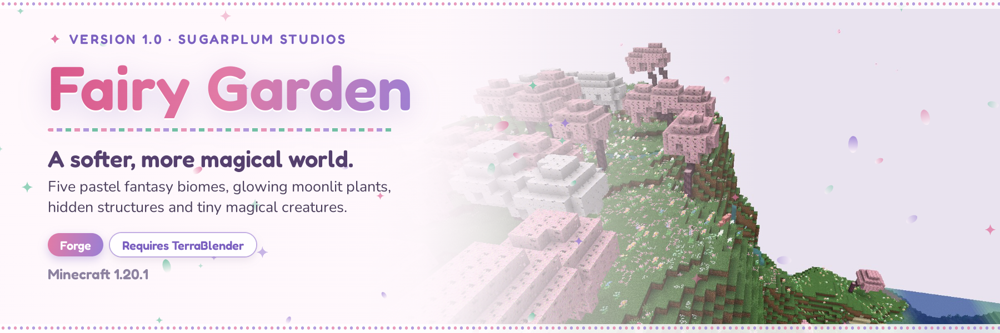

## A softer, more magical world.

**Fairy Garden** adds **five pastel fantasy biomes** to the Overworld: blossom-filled valleys, combed lavender fields, strawberry meadows, a glowing moonlit forest and crystal-studded fairy glades. Explore them for **four hidden structures** and buried fairy caches, grow **plants that only ripen by moonlight**, build with **two new wood sets**, and meet **butterflies** by day and **moon wisps** by night.

The biomes are fitted into vanilla terrain with **TerraBlender**, so they sit alongside the vanilla biomes and other biome mods instead of replacing your world.

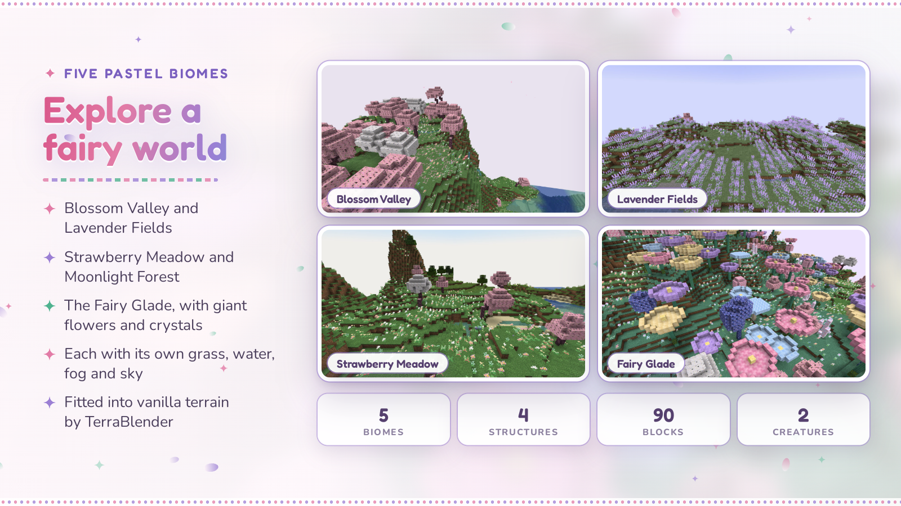

| Biome | Takes the place of | What you'll find |
| --- | --- | --- |
| 🌸 **Blossom Valley** | Meadows, cherry groves, birch forests | Pink and snow blossom trees, drifting petals, meandering streams banked with bluebells, hydrangeas and foxgloves |
| 💜 **Lavender Fields** | Sunflower plains, savannas | Long combed rows of lavender with grassy paths and meadow clearings, small blossom trees, the hum of bees |
| 🍓 **Strawberry Meadow** | Plains | Wild strawberry bushes, fairy rings of little mushrooms, huge fairy mushrooms, hydrangeas, foxes and rabbits |
| 🌙 **Moonlight Forest** | Dark forests | Tall moonwood trees, glowcap rings and huge glowcaps, moonflowers and moonbells, periwinkle grass, moon wisps |
| ✨ **Fairy Glade** | Flower forests, old growth birch forests | Crystal spires, giant flowers with glowing pistils, enchanted ponds with glimmer lilies, fairy rings, moon wisps |

- Each biome has its own **grass, foliage, water, fog and sky colours**, its own **ambient sounds** and its own **flower mix**.
- The biomes appear in one TerraBlender region, inside the vanilla climate the biome they replace would have, so they fit their surroundings.
- All five can be made rarer, more common or turned off one by one (see **Configuration**).

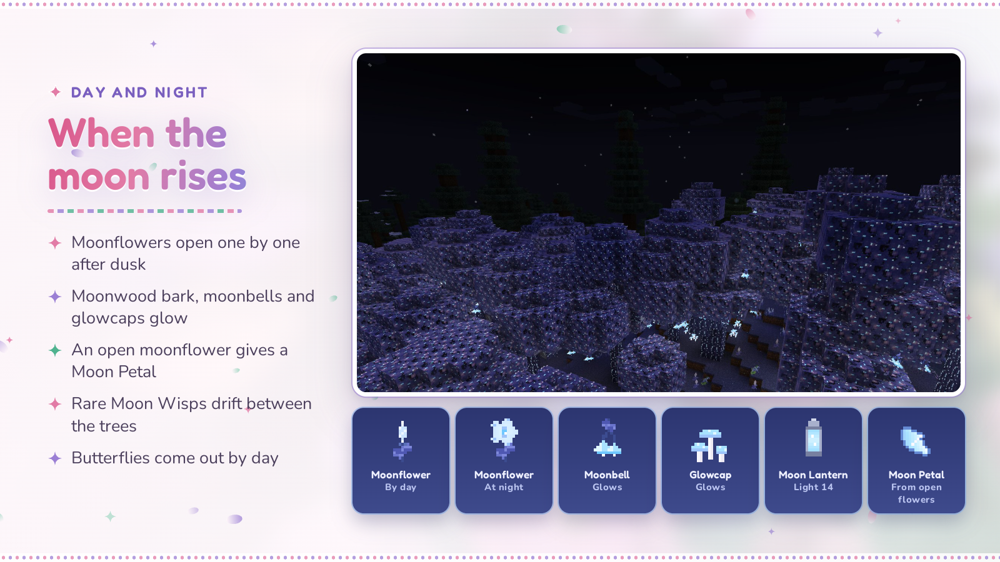

Fairy Garden changes after dark.

- **Moonflowers** close by day and **open one by one at night** (light 11 when open). An open moonflower drops a **Moon Petal**.
- **Starbloom** only grows at night under the open sky (see **Magical Plants**).
- **Moonwood** bark has glowing veins, and **moonbells** (light 12), **glowcaps** (light 8) and **glimmer lilies** (light 9) light up the Moonlight Forest and the glades.
- **Moon wisps** come out at night in the Moonlight Forest and the Fairy Glade, and fade away at sunrise.
- **Butterflies** flutter over the meadows by day.

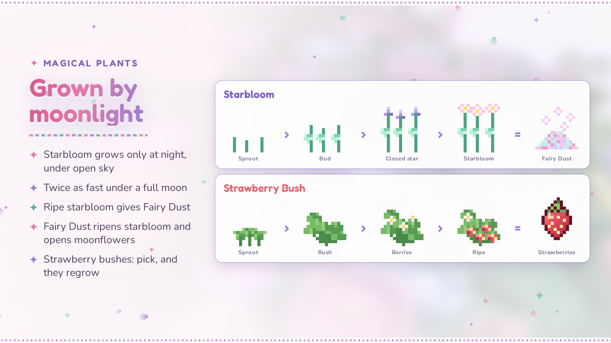

| Plant | How it works |
| --- | --- |
| **Starbloom** | Plant **Starbloom Seeds** on farmland. It grows only **at night under the open sky**, about **twice as fast under a full moon**, and never pops off in the dark. A ripe starbloom drops **1 or 2 Fairy Dust** and seeds |
| **Fairy Dust** | A magical fertiliser. Use it on a starbloom to ripen it at once (even by day), on a closed moonflower to open it on the spot, or on any other plant for **three rounds of bone meal growth** |
| **Moonflower** | Opens at night and closes by day. Break an open one for a **Moon Petal** |
| **Strawberry Bush** | Thornless. Once berries show, right-click it to pick **1 or 2 Strawberries** (one more when it's fully ripe); it goes back a stage and grows again |
| **Glimmer Lily** | A glowing lily pad. Craft one from a lily pad and fairy dust |
| **Fairy Mushroom and Glowcap** | Little mushrooms that grow into **huge mushrooms** with bone meal. Glowcaps glow |

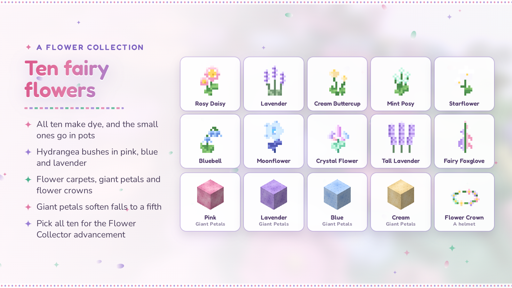

**Ten fairy flowers:** Rosy Daisy, Lavender, Cream Buttercup, Mint Posy, Starflower, Bluebell, Moonflower, Crystal Flower (light 7), Tall Lavender and Fairy Foxglove.

- Every flower **makes a dye**, and the small ones (and the saplings and mushrooms) **go in flower pots**.
- **Hydrangeas** in pink, blue and lavender are round bushes you can bump into and see over.
- **Flower carpets** in pink, lavender, cream, mint and blue: four from two flowers and a moss carpet.
- **Giant Petals** in pink, lavender, blue and cream are crafted from four petals or flowers, and **soften falls to a fifth** of the damage.
- **Blossom Petals** and **Snow Blossom Petals** lie on the ground like pink petals, one to four to a block.
- A **Flower Crown** is a helmet woven from five fairy flowers and a string.
- Pick all ten flowers for the **Flower Collector** advancement.

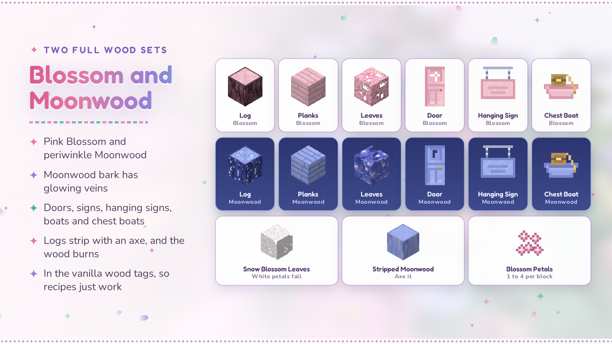

| Wood | Look | Grows in |
| --- | --- | --- |
| **Blossom** | Pink wood with pink or snow-white blossom leaves that shed petals | Blossom Valley, Lavender Fields, Strawberry Meadow, Fairy Glade |
| **Moonwood** | Periwinkle wood with glowing veins and purple leaves that let off moonlight glimmers | Moonlight Forest, Fairy Glade |

- Each set has **logs, wood, stripped logs and wood, planks, stairs, slabs, fences, fence gates, doors, trapdoors, buttons, pressure plates, signs, hanging signs, boats and chest boats**.
- Logs **strip with an axe**, and the wood **burns** like vanilla wood.
- Everything is in the **vanilla wood tags**, so vanilla recipes like sticks, chests and crafting tables just work.
- Three saplings: Blossom, Snow Blossom and Moonwood (which glows a little).

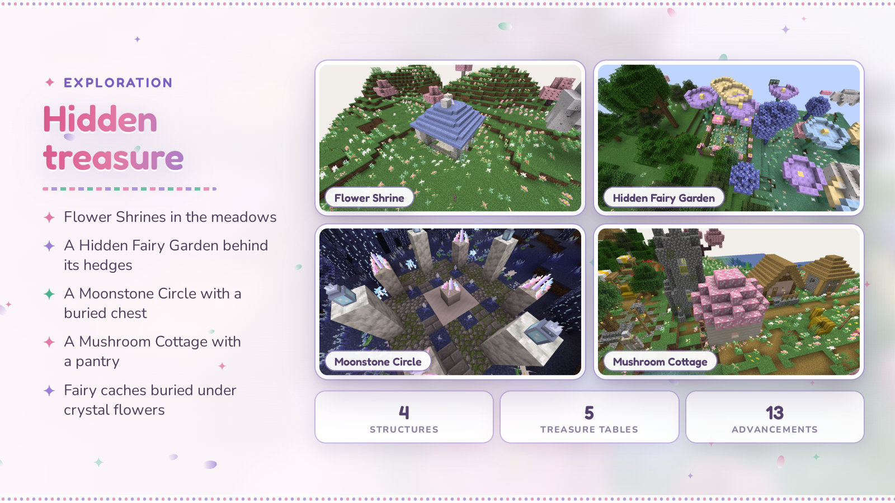

| Structure | Where | What's there |
| --- | --- | --- |
| **Flower Shrine** | Blossom Valley, Lavender Fields, Strawberry Meadow | A little roofed pavilion with four flower beds and a crystal-flower altar, in a blossom or a lavender style, with a chest behind it |
| **Hidden Fairy Garden** | Fairy Glade, Blossom Valley | A walled secret garden: flowering hedges, an arched gate, giant flowers, a lily pond, lantern posts, a crystal nook and a chest tucked behind the hydrangeas |
| **Moonstone Circle** | Moonlight Forest | A ring of pale standing stones crowned with moon lanterns and crystals around an altar ringed by moonflowers, with treasure buried beneath it |
| **Mushroom Cottage** | Strawberry Meadow, Fairy Glade | A fairy's home inside a giant spotted mushroom, with a bed, a workbench, flower pots, a garden and a pantry chest |
| **Fairy Cache** | All five biomes, rarely | A chest buried two blocks under a crystal flower inside a small ring of fairy mushrooms. Learn to read the ring and dig straight down |

The chests hold fairy dust, crystal shards, moon petals, seeds and saplings, flower crowns and lavender tea, with a chance of emeralds, diamonds, golden apples and enchanted books. The Hidden Fairy Garden can even hide an **enchanted golden apple**.

**13 advancements** follow you from your first fairy flower to visiting all five biomes, finding fairy treasure and harvesting a moon petal.

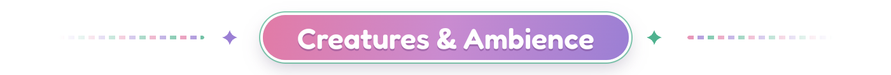

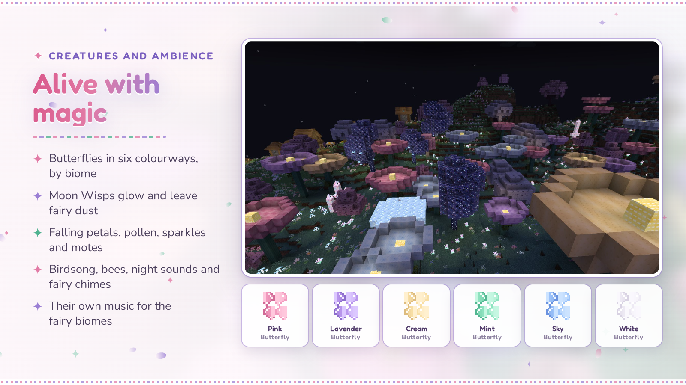

| Creature | |
| --- | --- |
| **Butterfly** | Six colourways (pink, lavender, cream, mint, sky and white), chosen by the biome. Butterflies flutter low over the meadows by day, drifting from flower to flower |
| **Moon Wisp** | A rare, glowing little spirit of the night in the Moonlight Forest and the Fairy Glade. Wisps are drawn to open moonflowers, trail moonlight and fade away at sunrise, leaving **fairy dust**. Wisps from a spawn egg, or with a name, stay |

Both are harmless, never take fall damage and don't trigger pressure plates. Both have spawn eggs.

- **Ambient particles:** drifting petals in Blossom Valley, butterflies over the meadows, moonlight motes after dark and fairy sparkles in the glades. They are client-side, follow the vanilla particle setting and can be turned down or off.
- **Ambient sounds:** birdsong in the valleys and meadows, bees in the lavender, night sounds in the Moonlight Forest and fairy chimes in the glades.
- **Fairy crystals** chime when you place, walk on or break them, and moonflowers make a soft sound when they bloom.
- The fairy biomes have **their own music track**.

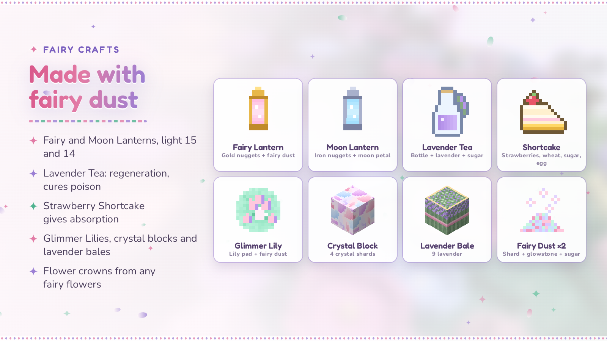

| Item | Recipe | |
| --- | --- | --- |
| **Fairy Dust ×2** | A crystal shard, glowstone dust and sugar | Also from ripe starbloom and moon wisps |
| **Fairy Lantern** | Eight gold nuggets around fairy dust | Light 15 |
| **Moon Lantern** | Eight iron nuggets around a moon petal | Light 14 |
| **Lavender Tea** | A glass bottle, two lavender and sugar | 10 seconds of Regeneration, cures poison and nausea, and you keep the bottle |
| **Strawberry Shortcake ×2** | Two strawberries, wheat, sugar and an egg | 30 seconds of Absorption |
| **Glimmer Lily** | A lily pad and fairy dust | Light 9 |
| **Flower Carpet ×4** | Two flowers of a colour and a moss carpet | |
| **Giant Petals** | Four blossom petals, lavender, bluebells or cream buttercups | |
| **Flower Crown** | Five fairy flowers and a string | A helmet |
| **Fairy Crystal Block** | Four crystal shards | Light 6 |
| **Lavender Bale** | Nine lavender | |
| **Giant Flower Stem ×3** | Three sugar cane | |
| **Giant Flower Pistil** | Glowstone, two cream buttercups and a honeycomb | Light 13 |

Crystal shards come from **fairy crystal clusters** (light 8), which drop two to four shards (more with Fortune) or themselves with Silk Touch.

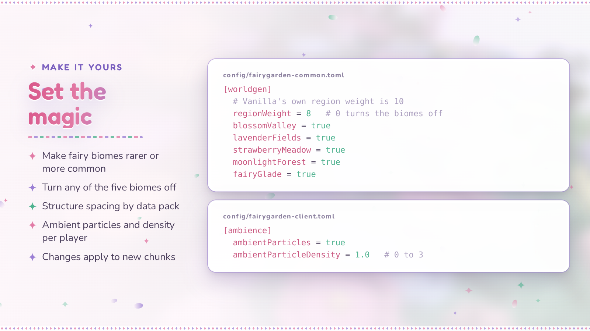

`config/fairygarden-common.toml` controls world generation. Changes apply to newly generated chunks after a restart.

| Setting | Default | |
| --- | --- | --- |
| `worldgen.regionWeight` | `8` | How often the Fairy Garden region appears compared with other TerraBlender regions (vanilla's own is 10). Higher means more fairy biomes; `0` turns them off |
| `worldgen.blossomValley` | `true` | |
| `worldgen.lavenderFields` | `true` | |
| `worldgen.strawberryMeadow` | `true` | |
| `worldgen.moonlightForest` | `true` | |
| `worldgen.fairyGlade` | `true` | |

`config/fairygarden-client.toml` sets the ambient particles for each player: `ambience.ambientParticles` (`true`) and `ambience.ambientParticleDensity` (`1.0`, from `0` to `3`).

Structure spacing, loot and the biome lists of each structure are ordinary data, so a data pack can change them.

- **One creative tab** with every block and item.
- **Light on performance:** ambient particles are client-side, only around the player, and scale with the vanilla particle setting. The only block entities are the signs.
- **Compostable** flowers, petals, seeds and plants, and **flammable** flowers, leaves and wood.
- **Tags for data packs**, such as `fairygarden:fairy_flowers`, and the vanilla flower, sapling, leaves and wood tags.

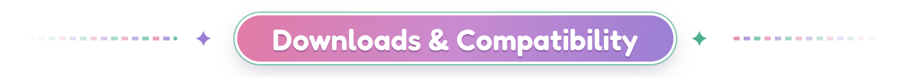

| Minecraft | Loader | Java | Also install |
| --- | --- | --- | --- |
| 1.20.1 | Forge 47 or newer | 17+ | [TerraBlender](https://www.curseforge.com/minecraft/mc-mods/terrablender) for Forge 1.20.1 |
| 1.20.1 | Fabric Loader 0.16.9 or newer | 17+ | [Fabric API](https://www.curseforge.com/minecraft/mc-mods/fabric-api) and [TerraBlender](https://www.curseforge.com/minecraft/mc-mods/terrablender) for Fabric 1.20.1 |
| 1.21.1 | NeoForge 21.1.80 or newer | 21+ | [TerraBlender](https://www.curseforge.com/minecraft/mc-mods/terrablender) for NeoForge 1.21.1 |
| 1.21.1 | Fabric Loader 0.16.9 or newer | 21+ | [Fabric API](https://www.curseforge.com/minecraft/mc-mods/fabric-api) and [TerraBlender](https://www.curseforge.com/minecraft/mc-mods/terrablender) for Fabric 1.21.1 |
| 26.2 | NeoForge 26.2.0.93 or newer | 25+ | [TerraBlender](https://www.curseforge.com/minecraft/mc-mods/terrablender) for NeoForge 26.2 |
| 26.2 | Fabric Loader 0.20.1 or newer | 25+ | [Fabric API](https://www.curseforge.com/minecraft/mc-mods/fabric-api) and [TerraBlender](https://www.curseforge.com/minecraft/mc-mods/terrablender) for Fabric 26.2 |
| 26.3 | NeoForge 26.3.0.97 or newer | 25+ | [TerraBlender](https://www.curseforge.com/minecraft/mc-mods/terrablender) for NeoForge 26.3 |
| 26.3 | Fabric Loader 0.20.1 or newer | 25+ | [Fabric API](https://www.curseforge.com/minecraft/mc-mods/fabric-api) and [TerraBlender](https://www.curseforge.com/minecraft/mc-mods/terrablender) for Fabric 26.3 |

- Install Fairy Garden and TerraBlender on **both the server and every client**.
- Fairy Garden is a mod. It does not work as a Paper, Spigot or Folia plugin.

**Do I need a new world?**
The biomes and structures only appear in chunks generated after you install the mod. In an existing world, travel to unexplored land.

**Why do I need TerraBlender?**
TerraBlender lets several mods add biomes to the Overworld side by side. Fairy Garden uses it to place its biomes without replacing vanilla's world generation.

**Does it work with other biome mods?**
TerraBlender is made for this: each mod adds its own regions to the Overworld, so Fairy Garden's biomes take turns with theirs. Other biome mods that don't use TerraBlender may override it.

**The fairy biomes are too rare (or too common). Can I change that?**
Raise or lower `worldgen.regionWeight` in `config/fairygarden-common.toml`. You can also turn single biomes off.

**My starbloom won't grow.**
It only grows at night, under the open sky. Nothing may cover it, and it needs farmland. Fairy dust ripens it at once.

**How do I find a structure?**
Use `/locate structure fairygarden:flower_shrine` (or `hidden_fairy_garden`, `moonstone_circle`, `mushroom_cottage`). In survival, explore the biomes each one appears in.

**Which loaders and versions are supported?**
Forge and Fabric for Minecraft 1.20.1, and NeoForge and Fabric for Minecraft 1.21.1, 26.2 and 26.3. Pick the file for your loader and Minecraft version; the Fabric files also need Fabric API.

More screenshots are in this project's **Gallery** tab.

---

Fairy Garden is made by Sugarplum Studios and released under the Apache License 2.0. The Fredoka and Nunito fonts used in this artwork are licensed under the SIL Open Font License 1.1.
